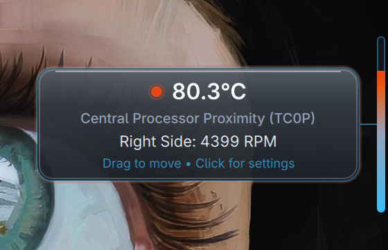

# Thermo

A quiet desktop thermometer for Omarchy: glance at the rail, hover for a readable glass badge with temperature and fan speeds.

**Created by Kairos Medical Informatics Ltd.** Open source, with contributions welcome.



## What it does today

- A stationary desktop-edge rail with a blue → neutral → orange → red temperature scale and blue outlines.
- A smoked glass badge that stays open while hovering the rail, connecting gap, or badge.
- Live hardware temperature and fan RPM, refreshed every 1.5 seconds.
- Optional blue companion fan rail, sharing the temperature rail’s position and hover interaction. Enable it in Settings. Tiny fan and heat symbols identify the rails when both are visible. It shows the first detected fan’s RPM relative to its reported maximum; missing readings or maximums are flagged rather than guessed.
- Click to open Settings; drag vertically to reposition. Default rail height: 127 pixels. Choose a monitor and either screen edge in Settings; the badge and fan rail always face inward.
- Apple SMC and CPU temperature detection, with a selectable sensor and Celsius/Fahrenheit display.
- Optional login autostart. Follow Omarchy appearance adapts badge and Settings colours, readable text, borders, font size/family, and window rounding live. Classic Glass retains the original smoked glass palette.

The rail lives behind application windows. It may be covered by them; it is intended as an ambient desktop display.

## Compatibility

Developed and verified on an **Intel MacBook running Omarchy and Hyprland on Wayland**. Other hardware and desktop environments are unverified. The current strip uses LayerShellQt; this is not a general X11 desktop widget.

Temperature and fan availability depends on the kernel's hwmon drivers. Apple SMC (`applesmc`) and CPU (`coretemp`) sensors are detected; other hwmon temperature sensors may also appear. No fan-control functionality is provided.

## Install from source on Omarchy / Arch Linux

Install build and runtime dependencies:

```bash
sudo pacman -S --needed base-devel git qt6-base qt6-declarative qt6-wayland layer-shell-qt
```

Then clone and install the local Arch package:

```bash
git clone https://github.com/jezmccole/thermo.git
cd thermo
./bin/install
```

`bin/install` builds the application, creates an Arch package with `makepkg`, and invokes package installation, which may request your password. Build as your regular user.

These instructions match the repository scripts; installation on a fresh machine has not yet been validated. There is no published AUR package or supported prebuilt release yet.

To build without installing:

```bash
./bin/build
./build/thermo --background
```

## Usage

```bash
thermo                 # Launch and show Settings
thermo settings        # Show Settings in the running instance
thermo --background    # Start quietly; duplicate background launches exit
thermo close           # Close Settings while Thermo is running
thermo toggle          # Toggle Settings while Thermo is running
thermo --json          # Print temperature sensors and default sensor ID; exit
thermo --version
thermo quit            # Quit the running instance
```

`--json` does not currently include saved configuration or fan readings. Each temperature sensor now includes `status` (`live` or `unavailable`) and `error` (empty, `missing`, `read_failed`, or `no_valid_sources`). `tempC` is a number for a valid reading and `null` otherwise; consumers must handle `null`. This one-shot snapshot has no historical reading to mark stale. A disappeared channel is absent from the snapshot; an unreadable channel that is still discoverable remains listed. `close`, `toggle`, and `quit` exit quietly if no instance is running.

To restart a running instance, run `thermo quit`, wait for it to exit, then run `thermo --background`.

In Settings, `Esc` or `Q` closes the window while keeping the rail active. Use **Refresh** to rescan sensors.

## Desktop placement and Settings

Choose **Primary display (automatic)** or a named monitor under Desktop placement. A disconnected saved monitor falls back to the primary display with a warning; the saved choice is retained and reapplied when it returns. Placement changes recreate only the desktop surface, leaving Settings open.

Both screen edges are supported. The temperature rail stays closest to the edge; the companion fan rail and badge face inward. Hover never moves the rails. Sizes use logical pixels so Qt applies display scaling automatically. The displayed height and vertical position are clamped to the available space while retaining your saved size and position; dragging saves a new position.

Settings has consistent page/card padding, grouped fields, and a scrolling page with persistent Close/Quit buttons. Content is centered and capped at 760 logical pixels in wide or tiled windows. Physical multi-monitor hotplug and additional hardware/display-scale combinations still need manual validation.

## Configuration and autostart

Preferences are stored in `${XDG_CONFIG_HOME:-~/.config}/thermo/config.json`. Settings saves changes automatically. Stop Thermo before editing this file manually, since shutdown writes the in-memory preferences back to disk.

Autostart is enabled by default. The **Launch on Startup** control manages `${XDG_CONFIG_HOME:-~/.config}/autostart/thermo.desktop`. The package does not add a Hyprland-specific startup entry.

The default sensor is Central Processor Proximity (`TC0P`) when available, then CPU package temperature, then a CPU average. Temperature scale bounds describe visual mapping, not hardware safety limits.

## Troubleshooting and current limitations

- **Cannot see the rail:** look at the right edge of the desktop with covering windows moved aside. Check that Thermo is running in a Wayland session.
- **Missing fan speed:** some hardware exposes no readable `fan*_input` entries. Missing or invalid fan readings are shown as unavailable; 0 RPM is a valid stopped-fan reading.
- **Sensor warning:** the rail turns amber and loses its temperature fill when the selected sensor is missing or faulty. The badge and Settings explicitly flag the problem. A real previous reading remains marked stale (`*` in the badge); Settings shows its last successful UTC timestamp. If there has been no valid reading, the display says Unavailable. Recovery is detected automatically on the next successful poll; switching sensors clears the previous sensor’s reading. Fault flags, malformed/non-finite readings, and values outside −20°C to 140°C are rejected. These are validity bounds, not hardware safety limits.
- **Unexpected temperature:** verify the selected sensor against the kernel's hwmon readings. CPU/system averages use fresh valid contributors on every poll and are unavailable when none are usable. Thermo is not a hardware safety alarm.
- **Theme matching:** choose Follow Omarchy or Classic Glass in Settings. Follow Omarchy reads `colors.toml` and supported scalar tokens from `shell.toml`, including popup background/text/border and font base size; fontconfig supplies the system font family. Borders expressed as gradients use their first colour stop. Missing or low-contrast tokens receive readable fallbacks. Font size is bounded to keep the compact badge usable; thermal colours remain blue-to-red and the fan rail blue.
- **Multiple installed copies:** `command -v thermo` shows which executable is used. A manually installed `~/.local/bin/thermo` may override the packaged `/usr/bin/thermo`.
- Temperature history remains planned. Monitor selection and either-edge placement are implemented; physical multi-monitor hotplug testing remains outstanding.

## Uninstall

Quit Thermo first, disable **Launch on Startup** in Settings, and remove the package:

```bash
sudo pacman -R thermo
```

If you previously installed a separate copy in `~/.local/bin`, remove that copy too. Preferences remain available for a future reinstall. Remove the Thermo configuration directory and its autostart desktop file manually if you want a complete cleanup. Remove any startup entries you added yourself separately.

## Development and contributions

```bash
./bin/build
./bin/test
./bin/check-runtime
```

Tests run offscreen with a temporary configuration directory. Hardware-independent fan fixtures cover labels, stopped fans, and invalid values; temperature fixtures cover failures, recovery, composite averages, and JSON availability without requiring host sensors. Hover, placement, and rendering require manual Wayland verification.

Report bugs through [GitHub issues](https://github.com/jezmccole/thermo/issues), including Thermo/Omarchy versions, hardware, sensor driver, reproduction steps, and relevant logs. Check screenshots and logs for personal information before sharing. Pull requests are welcome: explain the problem, keep the change focused, and include relevant validation.

Read the [product requirements](PRD.md) and [roadmap](ROADMAP.md) before starting a larger feature. See [CONTRIBUTING.md](CONTRIBUTING.md) for the workflow, manual checks, and pull-request guidance. GitHub Actions builds and tests in a fresh Arch container and checks package installation, reinstall, and removal. Its artifacts are development packages; [release-readiness checks](docs/RELEASE-CHECKLIST.md) remain explicit.

## Attribution and licence

Created by **Kairos Medical Informatics Ltd**. Maintained at [jezmccole/thermo](https://github.com/jezmccole/thermo).

Released under the [MIT licence](LICENSE). Existing copyright and third-party notices are preserved, including the Omacut / Monologue template attribution.
